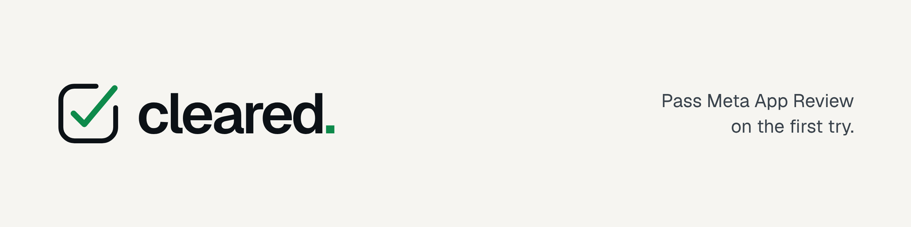

<p align="center">
  <picture>
    <source media="(prefers-color-scheme: dark)" srcset=".github/assets/banner-dark.png">
    
  </picture>
</p>

Getting an app through Meta App Review means the same work every time: a data deletion callback that verifies the signed request, a deauthorize callback, public policy pages, working webhooks, and a screencast that shows the reviewer exactly what they asked for. Most rejections come from one of those being missing or slightly wrong.

cleared does that work for you:

- **Callbacks.** Data deletion and deauthorize handlers for Express, Next.js and anything that speaks the Web `Request` API, with the status page Meta expects.
- **Doctor.** `npx cleared doctor` reads your app settings through the Graph API, tests your URLs, webhooks and callbacks, and tells you what will get you rejected before you submit.
- **Playbooks.** For each common permission: what the reviewer needs to see, the screencast steps, and a template for the reviewer notes.

> **Status:** 0.1.0, early development. The callbacks are ready: signed request parsing, the data deletion and deauthorize handlers, the status page and the Express and Next.js adapters, with an [example app](examples/express), a [callbacks guide](docs/callbacks.md) and the first [rejection pages](docs/rejections/README.md). `cleared doctor` checks the environment, the app settings it can read through the Graph API, your policy pages, your webhook subscriptions and, with `--deletion-url`, your data deletion callback. Follow the [roadmap](ROADMAP.md) for the rest.

## Install

```
npm install cleared
```

Requires Node.js 20 or later.

## Data deletion callback

```ts
import { createDataDeletionHandler } from 'cleared';

export const handleDeletion = createDataDeletionHandler({
  appSecret: process.env.META_APP_SECRET!,
  statusUrl: 'https://example.com/deletion-status',
  onDelete: async ({ userId }) => {
    await deleteUserData(userId);
  },
});
```

The handler takes a Web `Request` and returns a `Response` with `url` and `confirmation_code`.

Serve the status page at the `statusUrl`, with the same store:

```ts
import {
  createDataDeletionHandler,
  createDeletionStatusHandler,
  createMemoryStatusStore,
} from 'cleared';

const store = createMemoryStatusStore();

export const handleDeletion = createDataDeletionHandler({ /* ... */ store });
export const handleStatus = createDeletionStatusHandler({ store, appName: 'Example App' });
```

The page is plain HTML without scripts. It shows the confirmation code and the state, in English or Arabic (`?lang=ar`, or the browser language).

## Deauthorize callback

```ts
import { createDeauthorizeHandler } from 'cleared';

export const handleDeauthorize = createDeauthorizeHandler({
  appSecret: process.env.META_APP_SECRET!,
  onDeauthorize: async ({ userId }) => {
    await revokeSessions(userId);
  },
});
```

It verifies the signed request, calls `onDeauthorize` and answers 200.

## Express

```ts
import express from 'express';
import { createMemoryStatusStore } from 'cleared';
import { dataDeletion, deauthorize, deletionStatus } from 'cleared/express';

const app = express();
const store = createMemoryStatusStore();
const appSecret = process.env.META_APP_SECRET!;

app.post(
  '/meta/deletion',
  dataDeletion({
    appSecret,
    statusUrl: 'https://example.com/meta/deletion-status',
    store,
    onDelete: ({ userId }) => deleteUserData(userId),
  }),
);
app.get('/meta/deletion-status', deletionStatus({ store, appName: 'Example App' }));
app.post(
  '/meta/deauthorize',
  deauthorize({
    appSecret,
    onDeauthorize: ({ userId }) => revokeSessions(userId),
  }),
);
```

The middleware works with or without `express.urlencoded()` in front of it, on Express 4 and 5. Errors from your hooks go to `next`. To mount any other Web handler, wrap it with `toExpress(handler)`.

## Next.js

With the App Router, each callback is a route file:

```ts
// lib/meta.ts
import { createMemoryStatusStore } from 'cleared';

export const store = createMemoryStatusStore();
export const appSecret = process.env.META_APP_SECRET!;
```

```ts
// app/meta/deletion/route.ts
import { dataDeletion } from 'cleared/next';
import { appSecret, store } from '@/lib/meta';

export const { POST } = dataDeletion({
  appSecret,
  statusUrl: 'https://example.com/meta/deletion-status',
  store,
  onDelete: ({ userId }) => deleteUserData(userId),
});
```

```ts
// app/meta/deletion-status/route.ts
import { deletionStatus } from 'cleared/next';
import { store } from '@/lib/meta';

export const { GET } = deletionStatus({ store, appName: 'Example App' });
```

```ts
// app/meta/deauthorize/route.ts
import { deauthorize } from 'cleared/next';
import { appSecret } from '@/lib/meta';

export const { POST } = deauthorize({
  appSecret,
  onDeauthorize: ({ userId }) => revokeSessions(userId),
});
```

The routes need the Node.js runtime, which is the default; the Edge runtime has no `node:crypto`. On serverless hosts the in-memory store doesn't survive between requests, so pass a `StatusStore` backed by your database.

## Hono, Bun, Deno and Workers

The core handlers take a Web `Request` and return a `Response`, so no adapter is needed:

```ts
// Hono
app.post('/meta/deletion', (c) => handleDeletion(c.req.raw));
app.get('/meta/deletion-status', (c) => handleStatus(c.req.raw));
app.post('/meta/deauthorize', (c) => handleDeauthorize(c.req.raw));
```

```ts
// Bun, Deno and Cloudflare Workers
const routes: Record<string, (request: Request) => Promise<Response>> = {
  '/meta/deletion': handleDeletion,
  '/meta/deletion-status': handleStatus,
  '/meta/deauthorize': handleDeauthorize,
};

export default {
  fetch(request: Request): Promise<Response> | Response {
    const route = routes[new URL(request.url).pathname];
    return route ? route(request) : new Response('Not found', { status: 404 });
  },
};
```

That object works as is with `bun run` and `deno serve`. On Workers, turn on the `nodejs_compat` compatibility flag for `node:crypto`, and keep statuses in KV or D1 instead of memory.

## Doctor

```
export META_APP_ID=1234567890
export META_APP_SECRET=...
npx cleared doctor
```

It reads your app settings through the Graph API with an app access token and checks the privacy policy URL, terms of service URL, app icon, category, app domains and deauthorize callback URL.

Then it loads your privacy policy and terms of service the way a reviewer would. A page must use HTTPS, load without a login and not redirect to a sign-in page. The privacy policy should also explain how people can ask for their data to be deleted; if the doctor can't find a mention of deletion in the page HTML, it asks you to check by hand.

It also reads your webhook subscriptions. An inactive subscription or a callback that isn't reachable over HTTPS is blocking. To test the verification handshake, it sends each callback a `GET` with `hub.mode=subscribe`, a random `hub.challenge` and a random `hub.verify_token`. Your real verify token is never sent, so a correct endpoint answers 403; if it echoes the challenge, the doctor asks you to fix the token check.

To test your data deletion callback, pass its URL:

```
npx cleared doctor --deletion-url https://example.com/meta/deletion
```

The doctor signs a test request with your app secret, the same way Meta does, for user ID `0`, and posts it to the URL. It expects a 200 with a JSON `url` and `confirmation_code`, and then loads the status page at that `url`. It also sends a request with a wrong signature, which your callback should reject. Your `onDelete` runs for user `0`, so make sure it does nothing for a user it doesn't know.

It prints a report with a green check for what passed, an amber `!` for what you need to check by hand and a red cross for what blocks your submission. It exits with 1 when something is blocking, so you can run it in CI. Add `--json` for a machine-readable report.

The secret is only read from the environment. The doctor sends it only to graph.facebook.com and never prints it or writes it anywhere. The test request to your callback carries a signature made with the secret, never the secret itself.

## Callbacks guide

[docs/callbacks.md](docs/callbacks.md) covers where the URLs go in the App Dashboard, what to change before going live, and how to test with a signed request. [examples/express](examples/express) is a working app you can run locally. If Meta reports a problem with a callback, look up the exact message in [docs/rejections](docs/rejections/README.md).

## Still stuck?

If you ran the doctor, fixed everything it found, and your app is still rejected, email me at [contact@omarelnasherty.com](mailto:contact@omarelnasherty.com) with the rejection message. I've taken apps through review for Messenger, Instagram and WhatsApp.

## Good to know

- cleared runs on your machine. Your app secret and tokens stay in your environment and are never sent anywhere except Meta's own API.
- Passing every check makes a rejection much less likely. It can't guarantee approval: the final call is always Meta's reviewer.
- Policy text is your responsibility. cleared checks that the required sections exist; it doesn't write legal text for you.

cleared is an independent project. It is not affiliated with, endorsed by, or sponsored by Meta Platforms, Inc.

## License

[MIT](LICENSE)
