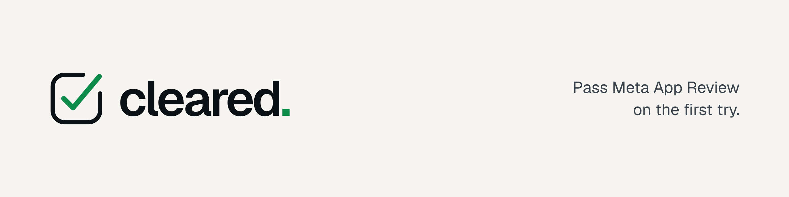

<p align="center">
  <picture>
    <source media="(prefers-color-scheme: dark)" srcset=".github/assets/banner-dark.png">
    
  </picture>
</p>

Getting an app through Meta App Review means the same work every time: a data deletion callback that verifies the signed request, a deauthorize callback, public policy pages, working webhooks, and a screencast that shows the reviewer exactly what they asked for. Most rejections come from one of those being missing or slightly wrong.

cleared does that work for you:

- **Callbacks.** Data deletion and deauthorize handlers for Express, Next.js and anything that speaks the Web `Request` API, with the status page Meta expects.
- **Doctor.** `npx cleared doctor` reads your app settings through the Graph API, tests your URLs, webhooks and callbacks, and tells you what will get you rejected before you submit.
- **Playbooks.** For each common permission: what the reviewer needs to see, the screencast steps, and a template for the reviewer notes.

> **Status:** early development. Follow the [roadmap](ROADMAP.md) for what works today.

## Install

```
npm install cleared
```

Requires Node.js 20 or later.

## Still stuck?

If you ran the doctor, fixed everything it found, and your app is still rejected, email me at [contact@omarelnasherty.com](mailto:contact@omarelnasherty.com) with the rejection message. I've taken apps through review for Messenger, Instagram and WhatsApp.

## Good to know

- cleared runs on your machine. Your app secret and tokens stay in your environment and are never sent anywhere except Meta's own API.
- Passing every check makes a rejection much less likely. It can't guarantee approval: the final call is always Meta's reviewer.
- Policy text is your responsibility. cleared checks that the required sections exist; it doesn't write legal text for you.

cleared is an independent project. It is not affiliated with, endorsed by, or sponsored by Meta Platforms, Inc.

## License

[MIT](LICENSE)
